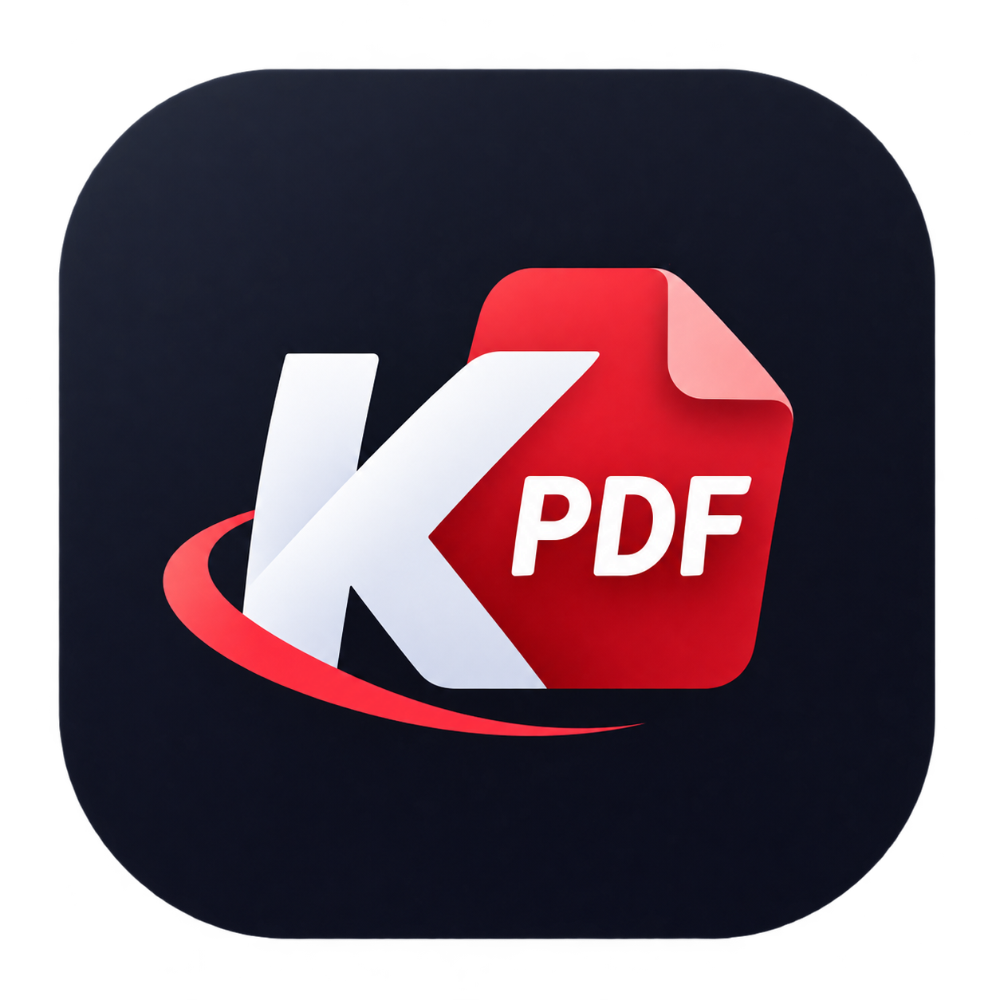

<p align="center">
  
</p>

<h1 align="center">K-PDF: PDF Editor & Tools</h1>

<p align="center">
  <strong>A high-performance, offline-first PDF editing, conversion, and manipulation powerhouse for Android.</strong>
</p>

<p align="center">
  <a href="https://kiphra.github.io/K-PDF/">
    
  </a>
  <a href="https://play.google.com/store/apps/details?id=com.kiphra.kpdf">
    
  </a>
  <a href="https://github.com/Kiphra/K-PDF/releases">
    
  </a>
  
  
</p>

---

## 🔒 100% On-Device & Privacy-First

Your documents are among the most sensitive files on your device. **K-PDF** is built with zero cloud dependencies:
- **Offline Processing:** All document operations (merging, splitting, compressing, converting, signing, OCR scanning) execute entirely within your device's local sandbox.
- **Zero Cloud Storage:** Your files never touch external servers or third-party cloud storage.
- **Complete Confidentiality:** No document telemetry, no contents inspection, and no tracking of file names or contents.

Read the official [Privacy Policy](https://kiphra.github.io/K-PDF/) for complete disclosures.

---

## ✨ Features

### 📄 Document Operations & Management
- **Merge PDF & Images** — Combine multiple PDFs and images (JPG, PNG, WebP) into a single unified document with visual reordering.
- **Split PDF** — Split documents into individual pages or custom page ranges.
- **Compress PDF** — Granular compression controls (Low, Medium, High, Extreme) to reduce file sizes instantly.
- **Reorder & Rotate** — Drag-and-drop page sequencing with 90°/180° rotation options.
- **Extract & Delete** — Extract specific pages into a new document or remove unwanted pages.

### 🔄 Conversion Tools
- **Images to PDF** — Convert gallery photos or scans into professional multi-page PDF documents.
- **PDF to Images** — Export PDF pages as high-resolution JPG or PNG images.
- **Scan to PDF** — Real-time camera document scanning with 4-point perspective warp and edge detection.
- **OCR Text Extraction** — Extract selectable, searchable text directly from scanned images and documents offline.

### ✏️ Editing, Signing & Imposition
- **Digital Signatures** — Draw and place reusable digital signatures on any PDF page.
- **Watermarking** — Apply customizable text or logo watermarks with transparency and angle controls.
- **Fill & Flatten Forms** — Complete interactive PDF form fields and flatten forms to finalize edits.
- **Print Imposition** — Advanced booklet layout formatting (N-Up, Cut & Stack, 2-Up, 4-Up) with LTR/RTL support.

### 🔐 Security & Vault
- **Lock PDF** — Encrypt and password-protect documents with standard 128-bit/256-bit encryption.
- **Unlock PDF** — Decrypt and remove passwords from protected PDFs (with valid authorization).
- **Metadata Editor** — View, edit, or strip PDF metadata (Title, Author, Subject, Keywords).

---

## 🛠️ Tech Stack & Architecture

- **Platform Target:** Google Play Store
- **Language:** Kotlin 100%
- **UI:** Jetpack Compose with Material 3 obsidian/crimson engineering design system
- **PDF Engine:** PdfBox-Android & Android `PdfRenderer`
- **OCR:** Google ML Kit Text Recognition (offline & on-device)
- **Scanning:** Google Mobile Services Document Scanner with edge detection
- **Async Concurrency:** Kotlin Coroutines & Flow
- **Data Persistence:** AndroidX DataStore & Room

---

## 🚀 Building from Source

```bash
# Clone the repository
git clone https://github.com/Kiphra/K-PDF.git
cd K-PDF

# Build debug APK
./gradlew :app:assembleDebug

# Build production release bundle (AAB)
./gradlew :app:bundleRelease
```

---

## 📬 Contact & Support

- **Publisher:** Kiphra
- **Support Email:** [kiphraofficial@gmail.com](mailto:kiphraofficial@gmail.com)
- **Official Privacy Policy:** [https://kiphra.github.io/K-PDF/](https://kiphra.github.io/K-PDF/)
- **Third-Party Notices:** [https://kiphra.github.io/K-PDF/licenses.html](https://kiphra.github.io/K-PDF/licenses.html)

---

&copy; 2026 Kiphra. All rights reserved.
